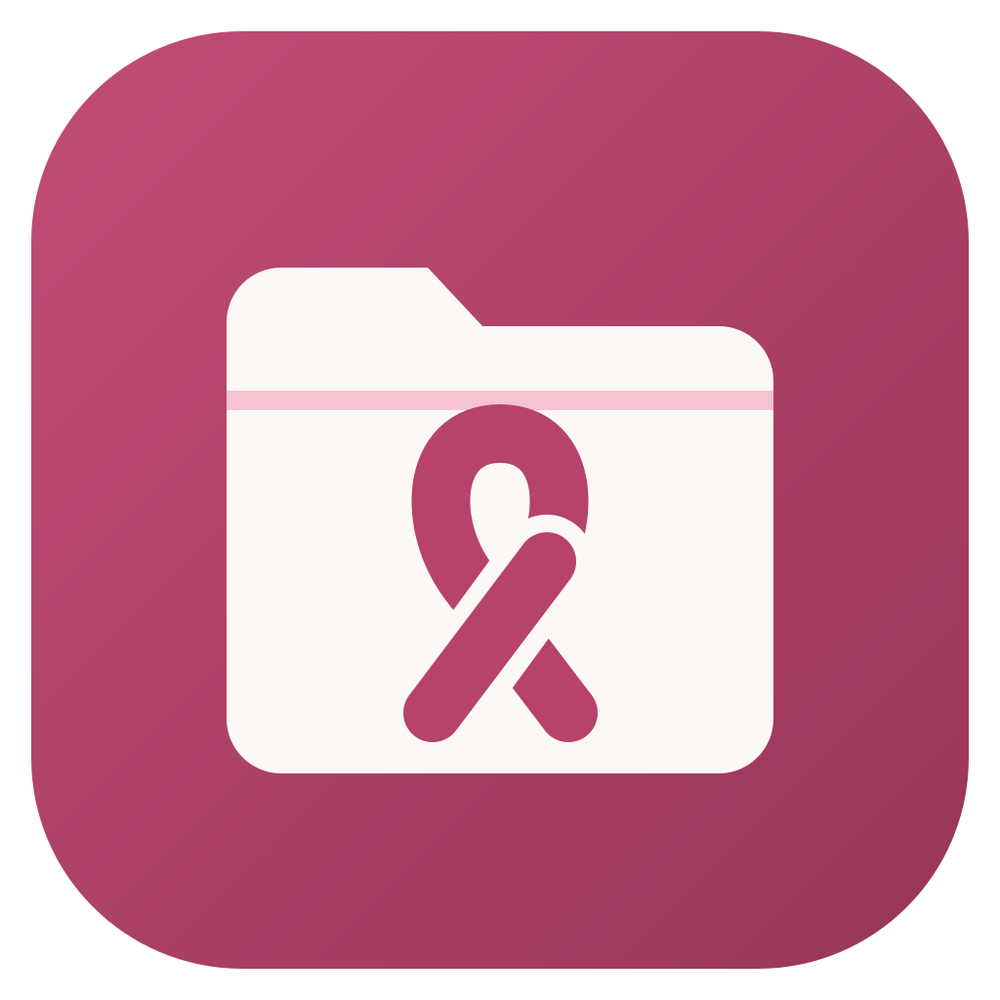
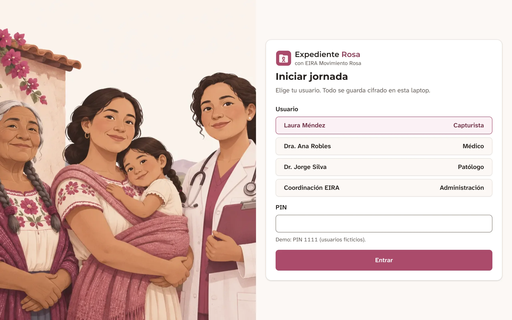
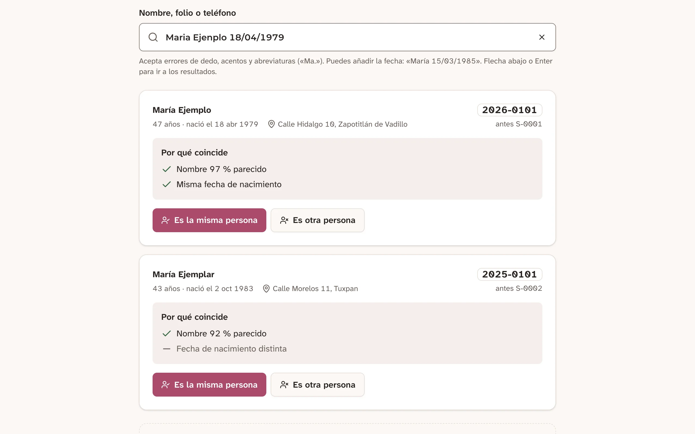
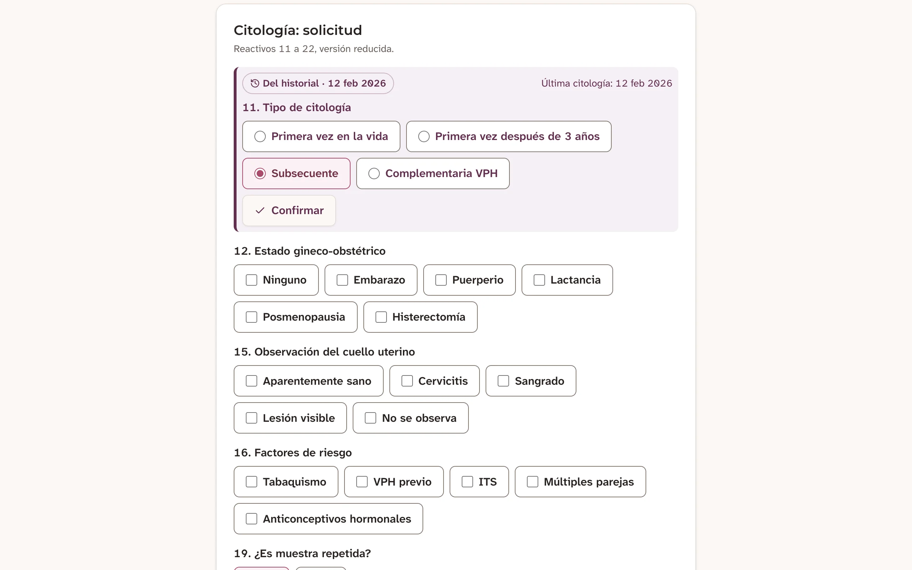
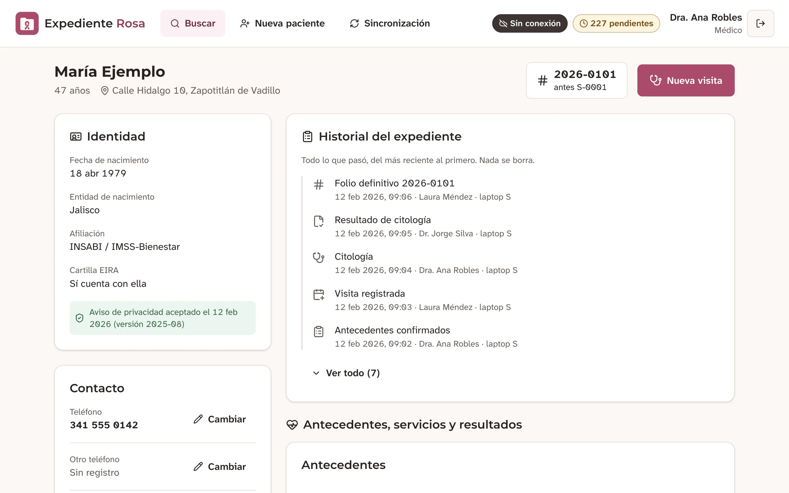
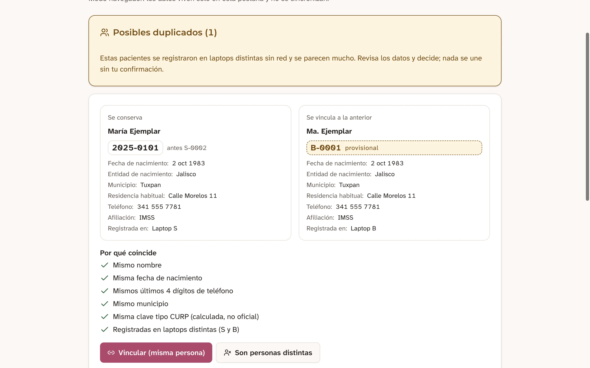
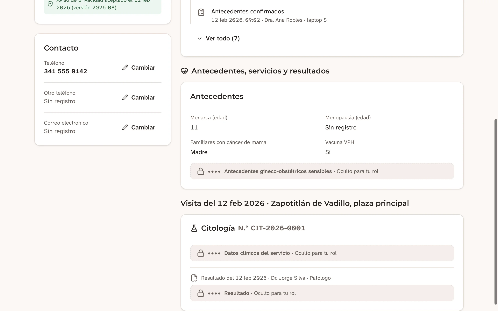

<p align="center">
  
</p>

<h1 align="center">Hilo</h1>

<p align="center">
  <strong>Una mujer, una historia.</strong> Un solo expediente por paciente, con o sin señal.<br />
  App de escritorio para <a href="https://eiraac.org/">EIRA Movimiento Rosa A.C.</a>: registra a cada paciente una sola vez, la reconoce cuando regresa y funciona en jornadas médicas sin internet.
</p>

<p align="center">
  Vibeathon Nerdearla México 2026 · Reto 1: Expediente digital único y registro de pacientes · Licencia MIT · Todos los datos son ficticios
</p>

---

## El problema

EIRA lleva prevención de cáncer de mama y cervicouterino a comunidades de Jalisco, Oaxaca, Guerrero y la sierra, a veces a 7 horas sin señal. Hoy cada atención se anota en hojas de papel y luego se pasa a Excel. A la paciente se le identifica por su nombre: **si regresa cuatro veces en un año, se registra cuatro veces**, y si el mismo día se hace Papanicolaou y ultrasonido, llena dos hojas con los mismos datos.

> "Después de 100 expedientes ya no sé si estoy capturando bien." — personal de EIRA, en la mentoría del hackathon

## Lo que hace

| | |
|---|---|
| **Reconoce a la paciente sin adivinar** | Busca por nombre, folio o teléfono, aunque haya errores de dedo o abreviaturas ("Ma."). Muestra **por qué** coincide cada resultado y **una persona decide**: "Es la misma persona" o "Es otra persona". Nunca fusiona expedientes por su cuenta. |
| **No vuelve a pedir lo que ya sabe** | En la segunda visita llena solo lo que ya conoce: la identidad, el tipo de citología ("subsecuente"), el número citológico anterior, la última mastografía y los antecedentes que no cambian. Solo se capturan los datos de hoy. |
| **Funciona todo el día sin internet** | Cada laptop guarda los expedientes **cifrados** en su disco. Al volver la señal (normalmente en la noche), sincroniza con una central y recibe el **folio EIRA definitivo**, sin números repetidos entre laptops. |
| **Cuida los datos sensibles** | La capturista no ve los antecedentes sensibles; el personal médico y la administración sí. Nada se borra. Cada cambio, y cada vez que alguien revela un dato sensible, queda registrado con quién, cuándo y desde qué laptop. |
| **No deja a nadie sin seguimiento** | Una lista muestra a las pacientes que deben volver (por ejemplo, una evaluación a seis meses) y cuándo. |

## Así se ve

| Inicio de jornada | Búsqueda con el porqué |
|---|---|
|  |  |
| **Segunda visita con datos del historial** | **Expediente e historial** |
|  |  |
| **Sincronización y posibles duplicados** | **La capturista no ve datos sensibles** |
|  |  |

## Qué es real, qué es simulado y qué no se probó

| ✅ Real (funciona en la demo) | 🟡 Simulado (para el hackathon) | ⚪ No probado o pendiente |
|---|---|---|
| Base de datos local **cifrada** con SQLCipher: sin la clave, el archivo es ilegible | Inicio de sesión: usuarios ficticios con PIN de demostración | La app **ejecutándose en Windows**: el instalador (MSI y NSIS) se genera en CI, pero nadie lo probó en una laptop Windows |
| Captura completa **sin internet** y sincronización al volver la red | Clave de cifrado de demostración (`jornada-demo`); en producción sería una frase por jornada | Probarla con el personal de EIRA en una jornada real |
| Central con **Valkey**: registro de eventos sin duplicados y **folio definitivo** consecutivo sin choques | Los **roles** se aplican en la interfaz; en producción el servidor también filtraría por rol | Borrado de expedientes a los 5 años: diseñado, no implementado |
| Búsqueda tolerante a errores con razones y **confirmación humana** | Datos de pacientes: todos ficticios | |
| Autollenado desde el historial y validaciones contra errores de captura | | |
| Duplicado creado en dos laptops sin red → propuesta de vincular → una persona decide | | |
| Resultado de citología (Bethesda) y mama (BI-RADS) capturado después por patólogo o médico | | |
| Respaldo y restauración (JSON), exportación de estadísticas sin datos personales (CSV) y hoja de contingencia imprimible | | |
| **Lista de seguimiento**: pacientes que requieren volver (por ejemplo, BI-RADS 3 a seis meses), sin mostrar hallazgos a la capturista | | |
| **Bitácora de accesos**: cada vez que el personal médico revela un dato sensible queda registrado; solo administración ve la lista | | |
| **Cartilla imprimible** con folio y un código QR que solo contiene el folio; se lee con la **cámara de la computadora** ("Escanear cartilla") o con un lector USB | | |
| **Hub entre laptops**: una laptop sirve a la otra por la red local, sin internet (probado con dos instancias en la misma Mac; falta probarlo con dos laptops por Wi-Fi) | | |

## Cómo probarlo

**Instalador de Windows:** [release v0.1.0](https://github.com/ultr4nerd/expediente-rosa/releases/tag/v0.1.0). Lo genera el CI; no está firmado y no se ha probado en una laptop Windows.

**Requisitos:** Node 24+, pnpm, Rust (estable), Docker.

```bash
pnpm install

# 1. Central (Valkey + servidor de sincronización) en http://localhost:8787
docker compose -f server/compose.yaml up -d

# 2. Laptop A
ER_DATA_DIR=/tmp/er-a ER_DEVICE=A pnpm tauri dev

# 3. Laptop B (otra ventana, mismo equipo, con datos separados)
ER_DATA_DIR=/tmp/er-b ER_DEVICE=B src-tauri/target/debug/expediente-rosa
```

Para ver solo la interfaz sin Rust ni Docker: `pnpm dev` y abre http://localhost:1420 (guarda en memoria).

**Usuarios de demostración** (ficticios):

| Usuario | Rol | PIN |
|---|---|---|
| Laura Méndez | Capturista | 1111 |
| Dra. Ana Robles | Médico | 2222 |
| Dr. Jorge Silva | Patólogo | 3333 |
| Coordinación EIRA | Administración | 0000 |

**Para reiniciar la demo:** `scripts/demo-reset.sh` borra los datos de las dos laptops y de la central. Al arrancar se cargan 30 pacientes ficticias, entre ellas María Ejemplo y María Ejemplar.

**Pruebas:** `pnpm verify` corre los 101 tests de TypeScript y las revisiones del proyecto. En `src-tauri/`, `cargo test` corre los 13 de Rust. En `server/`, `npm test` corre los 12 de la central contra un Valkey real.

## Cómo funciona

```
 Laptop A (Tauri)                         Central (cuando hay internet)
 ┌─────────────────────────┐             ┌───────────────────────────────┐
 │ Interfaz (React)        │             │ Servidor Hono                 │
 │ Reglas: búsqueda,       │   HTTP      │ Valkey Streams: registro de   │
 │ autollenado, duplicados │ ──────────► │ eventos, sin duplicados       │
 │ SQLite cifrado (Rust)   │ ◄────────── │ Contador atómico de folios    │
 └─────────────────────────┘             └───────────────────────────────┘
 Laptop B: igual, con su propia base cifrada
```

- **Cada cambio es un evento que nunca se borra.** Alta, cambio de teléfono, visita, resultado, vinculación… Con eso, el historial, la bitácora y la sincronización salen de lo mismo: sincronizar es intercambiar los eventos que la otra parte no tiene.
- **Folio sin choques.** Sin red, la laptop pone un folio provisional que se ve distinto (`A-0007`). Al sincronizar, Valkey asigna el consecutivo del año (`2026-0143`) con una operación atómica. El provisional sigue sirviendo para buscar.
- **Valkey listo para crecer y con permisos mínimos.** Todas las llaves comparten el prefijo `{er}`, así que el script atómico funciona igual en Valkey Cluster. La central entra con un usuario ACL que solo puede usar los comandos que necesita sobre sus propias llaves.
- **Siempre se busca antes de registrar.** Si la búsqueda no encuentra a la paciente, el registro se abre con lo que ya se escribió (nombre, fecha, teléfono). Así es más difícil crear un duplicado sin darse cuenta.
- **¿Por qué app de escritorio y no web?** Lo que guarda un navegador se puede borrar al limpiar sus datos, y no va cifrado. En una laptop que viaja a comunidades, con expedientes que se conservan 5 años, eso no es aceptable.

Más detalle técnico en [`docs/`](docs/INDEX.md): decisiones de diseño, el contrato de sincronización y el contexto de EIRA.

## Privacidad y seguridad

- **Datos mínimos:** los campos salen de los formatos reales de EIRA.
- **Cifrado** en la laptop.
- **Permisos por rol:** la capturista no ve los antecedentes sensibles; el personal médico y la administración sí. Solo administración puede descargar el respaldo completo.
- **Nada se borra:** cada cambio guarda autor, rol, laptop y hora.
- **Exportaciones sin datos personales:** el CSV solo lleva conteos.
- **Sin fusiones automáticas:** el nombre nunca se usa como identificador.
- **Contingencia:** respaldo JSON y una hoja de papel imprimible, por si la laptop falla.

## Para un piloto real con EIRA

**Operación**

- **Quién lo administra:** la coordinación de EIRA (respaldos, usuarios, central).
- **Capacitación:** estimamos unos 30 minutos. El flujo sigue el orden de las hojas que ya usan, y se captura con teclado.
- **Respaldo:** la central guarda cada evento en disco antes de confirmarlo. Además, cada laptop puede exportar su respaldo.

**Costos (estimados)**

- **Licencias:** $0 (código abierto, MIT).
- **Laptops:** las que EIRA ya tiene.
- **Central:** un servidor pequeño con Valkey (por ejemplo, Valkey gestionado en AWS o una máquina virtual chica), del orden de **USD 10 a 30 al mes**.

**Riesgos**

- La central y el hub no tienen autenticación ni cifrado en tránsito: hoy solo deben usarse en la red propia de la jornada. El respaldo JSON va sin cifrar (por eso solo lo descarga administración).
- No se ha probado en sus laptops Windows ni con WebView2 sin conexión.
- Los instaladores no van firmados, así que Windows mostrará una advertencia.
- Una laptop robada está protegida por el cifrado, pero la clave de la demo es fija.
- Falta una revisión jurídica y de protección de datos personales sensibles.

**Próximos pasos**

1. Validar los flujos con el personal operativo y clínico de EIRA.
2. Autenticación real y clave de cifrado por jornada.
3. Filtrado por rol también en la central.
4. Probar en sus laptops con datos sintéticos.
5. Hacer un piloto acotado en una jornada.
6. Implementar la conservación y el borrado a 5 años.

## Supuestos que hay que validar con EIRA

Los tomamos de la guía y de la mentoría del hackathon:

- El internet vuelve normalmente la misma noche.
- Hay unas dos laptops por jornada.
- Una sola persona captura a cada paciente.
- Solo el personal médico ve y corrige los antecedentes sensibles.
- Los expedientes se conservan unos 5 años y la paciente firma un aviso de privacidad.

## Preguntas abiertas para EIRA

- ¿El folio tiene que quedar escrito en la hoja o en la Cartilla EIRA el mismo día, o puede asignarse en la noche al sincronizar?
- ¿Una misma paciente pasa por las dos laptops el mismo día? Si es así, el hub entre laptops se vuelve prioritario.
- ¿El patólogo captura los resultados en una laptop de EIRA o desde su laboratorio?
- ¿Qué trae impreso la Cartilla EIRA? ¿Podría llevar el folio o un código QR?
- Si dos expedientes resultan ser la misma persona, uno de los dos folios definitivos queda como alias y ese número no se reutiliza. ¿Es aceptable ese hueco en el consecutivo, como un oficio cancelado?

## Créditos

Hecho en la Vibeathon de Nerdearla México 2026 (Amazon CDMX, 21 de noviembre de 2026) para EIRA Movimiento Rosa A.C., con el apoyo de sus mentoras y mentores. EIRA no avala este prototipo: el hackathon no equivale a una autorización de uso con pacientes reales.

¿Vas a contribuir con código o con un agente de IA? Empieza por [`AGENTS.md`](AGENTS.md).
